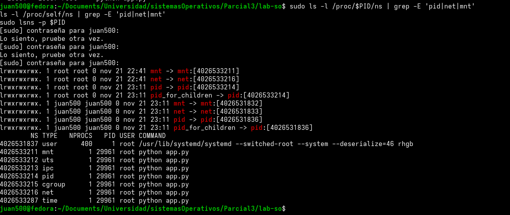
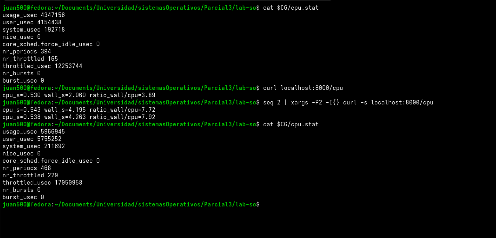
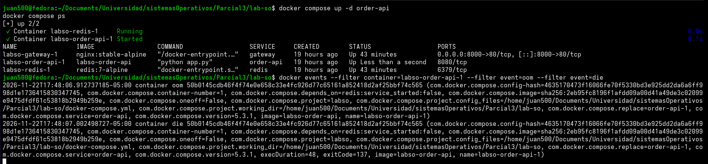
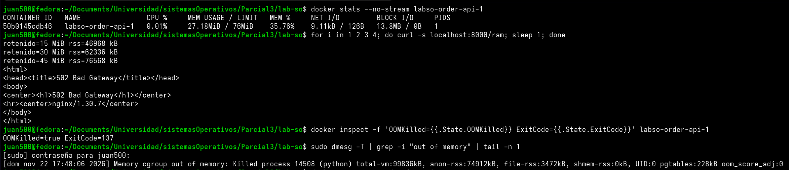

## 1. Datos
- Nombre:Juan Andres Muñoz Zapata
- Código:"No pondre mi cdigo ya que el repo sera publico se envia por chat privado"
- Usuario de GitHub:Visita [My github](https://github.com/JuanTrader500) 

## Practica 1

### Mi entorno (Tabla 1)

| Dato | Hardware físico | Lo que ve Linux / WSL2 |
|---|---|---|
| Núcleos | 8 núcleos físicos, 12 hilos (Intel Core i5-12450H) | 12 (`nproc`) |
| RAM | 8 GiB (4 × 2 GiB LPDDR5) | 7,4 GiB ≈ 7619 MiB (`free -h` / `free -m`) |
| Versión de cgroups | — | cgroup v2 (`stat -fc %T /sys/fs/cgroup` → `cgroup2fs`) |

**Datos adicionales de la Práctica 1**

| Comando | Resultado en mi equipo |
|---|---|
| `nproc` | 12 |
| `free -h` | Mem total 7,4Gi · Swap 7,4Gi |
| `uname -r` | 7.2.10-200.fc44.x86_64 |
| `stat -fc %T /sys/fs/cgroup` | cgroup2fs |
| `ulimit -n` | 1024 |
| `df -Th /` | btrfs (475G, 20 % usado) |

**Qué observé:** Mi equipo usa Fedora Linux directamente, sin WSL2. Por eso Linux ve todo el hardware real:
los 12 hilos del procesador y casi toda la RAM (7,4 GiB de los 8 GiB instalados).
Mi kernel usa cgroups v2 (`cgroup2fs`), igual que pide la guía. Algunas cosas son distintas a lo que describe
la guía para WSL2: mi swap no es 0B (tengo 7,4 GiB), el kernel no termina en `microsoft-standard-WSL2` y mi disco es btrfs en vez de ext4.

#Evidencias ejecucion de las practicas.

## Practica 2

### Captura del paso 2 

### Captura del paso 3

### Captura del paso 4

## Practica 3

## Practica 4

# Tabla 7 — Predicción vs. realidad (Prácticas 3 a 6)

"Diferencia" = medido − predicho.

| Prueba | Predicho (calculos.py o guía) | Medido | Diferencia | ¿Por qué? |
|---|---|---|---|---|
| `ratio_wall/cpu` con 1 petición | ≈ 4 | 3.89 | −0.11 | Con `cpu.max = 25000 100000` el kernel deja trabajar a la API 25 ms de cada 100 ms y la pausa los otros 75 ms, así que el mismo trabajo tarda unas 4 veces más. La diferencia es ruido normal de medición. |
| `ratio_wall/cpu` con 2 peticiones | ≈ 8 | 7.72 y 7.92 | −0.28 y −0.08 | Las dos peticiones se turnan la misma cuota de 25 ms por ciclo, así que cada una tarda el doble que sola. El contador `nr_throttled` subió de 165 a 229 (+64) durante la prueba. |
| Memoria base de la API | 20 MiB | _pendiente (P4)_ | | |
| Llamada a `/ram` que dispara el OOM | 4.ª | _pendiente (P4)_ | | |
| Exit code tras el OOM | 137 | _pendiente (P4)_ | | |
| Descriptores con N = 50 | 105 | _pendiente (P5)_ | | |
| Descriptores con N = 100 | 205 | _pendiente (P5)_ | | |
| Máximo de peticiones simultáneas | 125 | _pendiente (P5)_ | | |
| Tiempo de `docker stop` con SIGTERM | ≈ 3 s | _pendiente (P6)_ | | |
| Exit code con SIGTERM | 0 | _pendiente (P6)_ | | |
| Tiempo de `docker stop` con SIGKILL | ≈ 10 s | _pendiente (P6)_ | | |
| Exit code con SIGKILL | 137 | _pendiente (P6)_ | | |

