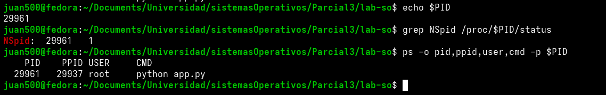
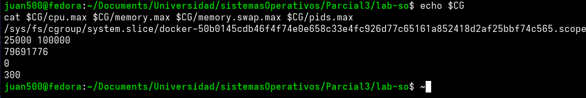

# Practica 1

## Mi entorno (Tabla 1)

| Dato | Hardware físico | Lo que ve Linux / WSL2 |
|---|---|---|
| Núcleos | 8 núcleos físicos, 12 hilos (Intel Core i5-12450H) | 12 (`nproc`) |
| RAM | 8 GiB (4 × 2 GiB LPDDR5) | 7,4 GiB ≈ 7619 MiB (`free -h` / `free -m`) |
| Versión de cgroups | — | cgroup v2 (`stat -fc %T /sys/fs/cgroup` → `cgroup2fs`) |

**Datos adicionales de la Práctica 1**

| Comando | Resultado en mi equipo |
|---|---|
| `nproc` | 12 |
| `free -h` | Mem total 7,4Gi · Swap 7,4Gi |
| `uname -r` | 7.2.10-200.fc44.x86_64 |
| `stat -fc %T /sys/fs/cgroup` | cgroup2fs |
| `ulimit -n` | 1024 |
| `df -Th /` | btrfs (475G, 20 % usado) |

**Qué observé:** Mi equipo usa Fedora Linux directamente, sin WSL2. Por eso Linux ve todo el hardware real:
los 12 hilos del procesador y casi toda la RAM (7,4 GiB de los 8 GiB instalados).
Mi kernel usa cgroups v2 (`cgroup2fs`), igual que pide la guía. Algunas cosas son distintas a lo que describe
la guía para WSL2: mi swap no es 0B (tengo 7,4 GiB), el kernel no termina en `microsoft-standard-WSL2` y mi disco es btrfs en vez de ext4.

# Practica 2

## Captura del paso 2 

## Captura del paso 3

## Captura del paso 4

